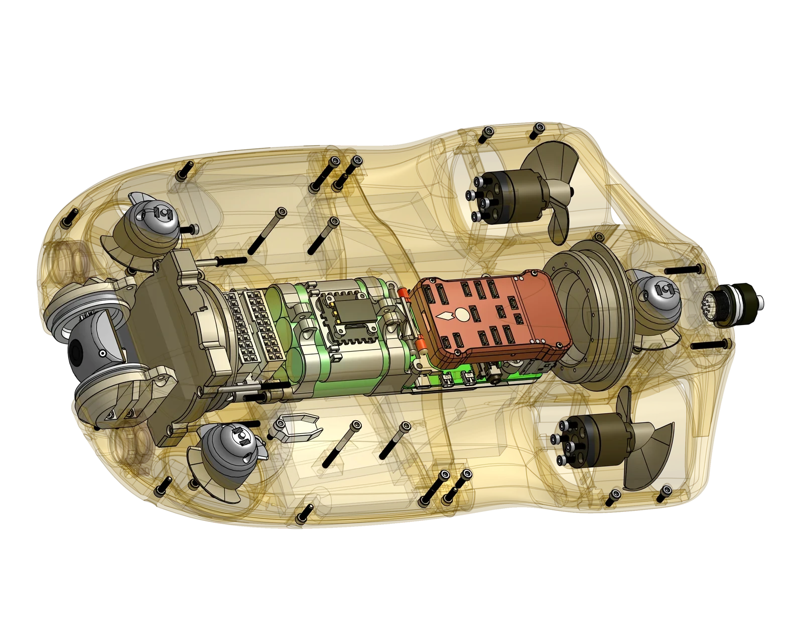

# OceanOptic

An underwater inspection ROV that finds structural defects in pipelines and dam walls. This repo holds the CAD model and the project website.

Live site: https://underwater-submersible.vercel.app



## The ROV

- 5 thrusters (3 vertical, 2 horizontal)
- Rated to 85 m, pressure tested at 8.5 bar
- 100 m Cat5e tether
- ArduSub on a Pixhawk, with a Raspberry Pi
- 3S 18650 battery pack, about 40 minutes per dive
- Camera feed goes up the tether, and defect detection runs at the surface

Won an Ingenious+ innovation award from the Rideau Hall Foundation.

## The site

Shows the real CAD as an interactive 3D model. You can rotate it, take it apart, or look inside the pressure tube.

## Tech

next.js, three.js

## Structure

```
cad/    Fusion 360 STEP export of the full assembly
site/   the website
```
